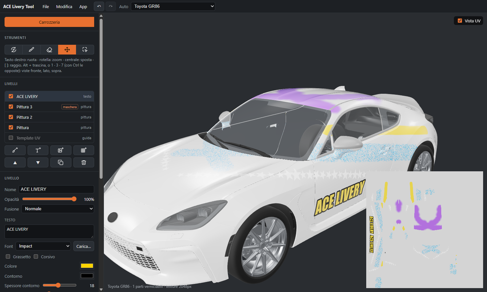

# ACE Livery Tool

*[English](README.md)*

Un editor 3D di livree per **Assetto Corsa EVO**: dipingi direttamente sull'auto, metti loghi, numeri e scritte
anche a cavallo dei pannelli, ed esporta una *External Livery* che il gioco carica.

La guida completa è nella **[wiki](https://github.com/agastal/AceLiveryTool-Release/wiki/Home)**: installazione, pittura, livelli, export, progetti, scorciatoie, problemi.

- Tutte le auto del gioco (71), con il loro layout UV come guida.
- Livelli con maschere, modi di fusione e rugosità, metallo e clear coat propri.
- Parti: un clic limita un livello al cofano, a una portiera, a un paraurti (e alla parte corrispondente
  dall'altro lato).
- Pennelli che lavorano in 3D (nessuna cucitura tra i pannelli): tondo, spray, timbri; simmetria sinistra/destra.
- Immagini e testi proiettati sull'auto, anche specchiati sull'altro lato.
- Annulla/ripeti, file di progetto (`.acelivery`); viste di fronte, lato e sopra come in Blender (1, 3, 7 o
  Alt + trascina).
- In italiano, inglese, francese, tedesco e spagnolo.
- **L'export** scrive una External Livery in `Saved Games\ACE\ExternalLiveries\<nome>\`, collegata a un'auto del
  tuo garage, e mostra le livree già presenti; ognuna, anche se non fatta con l'app, si può aprire nell'editor e
  modificare.

## Installazione

Requisiti: Windows 10 o 11 (64 bit) e Assetto Corsa EVO installato tramite Steam.

1. Scarica `AceLiveryTool-<versione>-setup.exe` da [Releases](../../releases/latest) e avvialo (installa solo per il
   tuo utente, senza diritti di amministratore).
2. Il setup non ha una firma digitale: Windows SmartScreen può dire "PC protetto da Windows". Scegli
   **Ulteriori informazioni → Esegui comunque**. Ogni release riporta lo SHA-256 del setup (`SHA256SUMS.txt`) e una
   scansione Microsoft Defender di quel file (`antivirus.txt`).

## Primo avvio: preparare le auto

L'app non contiene **nessuna parte del gioco**. Al primo avvio legge le auto dalla tua installazione e le tiene in
`%LOCALAPPDATA%\ace-livery-tool\cars` (circa un minuto e 550 MB). Trova il gioco nelle librerie di Steam; se non
ci riesce, *Scegli la cartella del gioco…* la indica a mano. Rifallo dopo un aggiornamento del gioco dall'elenco
delle auto nella barra in alto, *Prepara di nuovo le auto dal gioco*. Quando una nuova versione dell'app ha
bisogno di più informazioni dalle auto, le prepara di nuovo da sola al primo avvio.

## Usare una livrea esportata

Una External Livery appartiene a **un'auto del tuo garage**, non al modello:

1. Nel gioco apri l'auto nel garage con un **allestimento base** e salva la configurazione. Le edizioni speciali
   con una livrea di fabbrica (per esempio la GR86 Trueno e Hakone) non accettano livree esterne; la finestra di
   export lo segnala.
2. Esporta dall'app e scegli quell'auto.
3. Riavvia il gioco (legge le livree solo all'avvio), apri l'auto nel **Paint Shop** e la prima volta scegli la
   livrea a mano.

Il gioco mostra **una sola** livrea per auto del garage: esportando con il nome della livrea già collegata la
sostituisci. Le parti nel colore del garage (su alcune auto un alettone o qualche finitura) non sono raggiunte da
una livrea esterna: l'editor le mostra in grigio.

## Sostegno

ACE Livery Tool è gratuito. Se ti piace, puoi sostenerlo con una donazione su [PayPal](https://www.paypal.com/paypalme/agastalink).

## Aggiornamenti

All'avvio e una volta al giorno l'app controlla se in questo repository c'è una release più nuova (si può
disattivare dal menu *App*) e propone di installarla: scarica il setup, ne verifica la firma e si riavvia.

## Privacy

L'app non invia nulla che ti riguardi. Si collega solo a **GitHub, questo repository**: per vedere se c'è una
release più nuova, e per scaricarla quando lo chiedi.

Legge i file del gioco dove li ha installati Steam, o nella cartella che scegli, e le auto del garage in
`Saved Games\ACE`. Scrive solo nelle sue cartelle (`%LOCALAPPDATA%\ace-livery-tool` per le auto;
`%APPDATA%\com.aceliverytool.app` e `%LOCALAPPDATA%\com.aceliverytool.app` per le impostazioni: lingua, ultima
auto, cartella del gioco, posizione della finestra), nelle cartelle delle livree che esporti e nei file di
progetto che scegli di salvare. Le livree che elimini dall'app finiscono nel Cestino; quelle che disattivi in
`Saved Games\ACE\ExternalLiveries_off`.

## Disinstallazione

Da Impostazioni di Windows → App. Le auto preparate restano in `%LOCALAPPDATA%\ace-livery-tool`: cancella anche
quella cartella per liberare lo spazio.

---

ACE Livery Tool non è affiliato a Kunos Simulazioni né a 505 Games. Assetto Corsa EVO e le sue auto appartengono
ai rispettivi proprietari.
