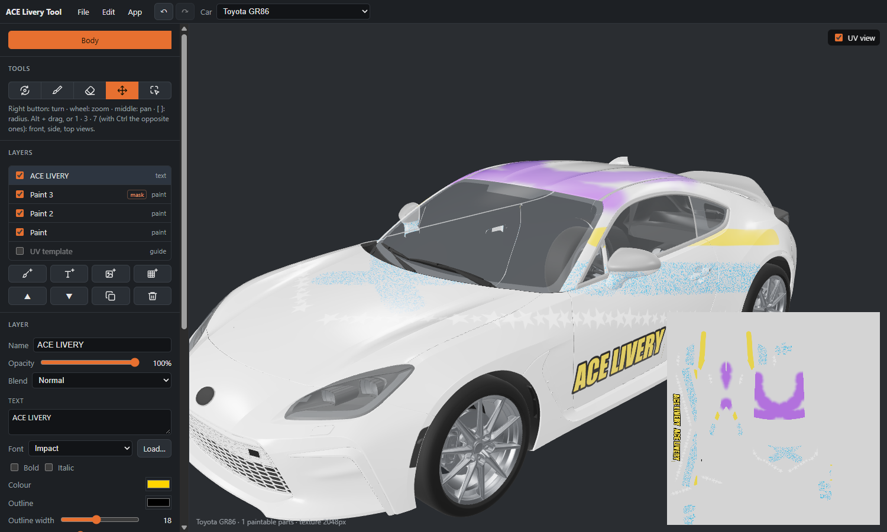

# ACE Livery Tool

*[Italiano](README.it.md)*

A 3D livery editor for **Assetto Corsa EVO**: paint straight on the car, place logos, numbers and text
across the panels, and export an *External Livery* the game loads.

The full guide is in the **[wiki](https://github.com/agastal/AceLiveryTool-Release/wiki)**: installation, painting, layers, export, projects, shortcuts, troubleshooting.

- Every car of the game (71), with its UV layout as a guide.
- Layers with masks, blend modes and their own roughness, metallic and clear coat.
- Parts: a click limits a layer to the hood, a door, a bumper (and the matching part on the other side).
- Brushes that work in 3D (no seams between panels): eleven ready-made ones (round, spray, chalk, carbon
  fibre, bristles, marker, nib, stamps…), left/right symmetry, pen pressure on a drawing tablet.
- Images (PNG, JPG, SVG) and text projected on the car, mirrored to the other side if you want.
- Undo/redo, project files (`.acelivery`); front, side and top views as in Blender (1, 3, 7 or Alt + drag).
- In Italian, English, French, German and Spanish.
- **Export** writes an External Livery into `Saved Games\ACE\ExternalLiveries\<name>\`, linked to a car of your
  garage, and lists the liveries already there; any of them, also one not made with the app, can be opened in the
  editor and changed.

## Install

Requirements: Windows 10 or 11 (64-bit) and Assetto Corsa EVO installed through Steam.

1. Download `AceLiveryTool-<version>-setup.exe` from [Releases](../../releases/latest) and run it (it installs for
   your user only, no administrator rights).
2. The setup is not code-signed: Windows SmartScreen may say "Windows protected your PC". Choose
   **More info → Run anyway**. Each release lists the setup's SHA-256 (`SHA256SUMS.txt`) and a Microsoft
   Defender scan of that exact file (`antivirus.txt`).

## First start: preparing the cars

The app ships **no part of the game**. On first start it reads the cars from your own installation and keeps
them in `%LOCALAPPDATA%\ace-livery-tool\cars` (about a minute and 550 MB). It finds the game in your Steam
libraries; if it does not, *Choose the game folder…* picks it by hand. Do it again after a game update from the
car list in the top bar, *Prepare the cars again from the game*. When a new version of the app needs more from
the cars, it prepares them again by itself at its first start.

## Using an exported livery

An External Livery belongs to **one car of your garage**, not to the car model:

1. In the game, open the car in the garage with a **base trim** and save its configuration. Special editions
   with a factory livery (e.g. the GR86 Trueno and Hakone) do not take external liveries; the export window
   says so.
2. Export from the app and choose that car.
3. Restart the game (it reads liveries only at start), open the car in the **Paint Shop** and pick the livery
   by hand the first time.

The game shows **one** livery per garage car: exporting over the name of the livery already linked to it replaces
that one. Parts in the garage's own colour (on some cars a wing or a few trims) are not reached by an external
livery: the editor shows them in grey.

## Support

ACE Livery Tool is free. If you like it, you can support it with a donation on [PayPal](https://www.paypal.com/paypalme/agastalink).

## Updates

The app checks this repository for a newer release at start and once a day (it can be switched off in the
*App* menu) and offers to install it: it downloads the setup, checks its signature and restarts.

## Privacy

The app sends nothing about you anywhere. It connects only to **GitHub, this repository**: to see whether there
is a newer release, and to download it when you ask.

It reads the game's files where Steam installed them, or in the folder you choose, and the garage cars in
`Saved Games\ACE`. It writes only to its own folders (`%LOCALAPPDATA%\ace-livery-tool` for the cars;
`%APPDATA%\com.aceliverytool.app` and `%LOCALAPPDATA%\com.aceliverytool.app` for its settings: language, last car,
game folder, the window's place), to the livery folders you export and to the project files you choose to save.
Liveries you delete from the app go to the Recycle Bin; those you turn off go to
`Saved Games\ACE\ExternalLiveries_off`.

## Uninstall

From Windows Settings → Apps. The prepared cars stay in `%LOCALAPPDATA%\ace-livery-tool`: delete that folder
too to free the space.

---

ACE Livery Tool is not affiliated with Kunos Simulazioni or 505 Games. Assetto Corsa EVO and its cars belong
to their owners.
